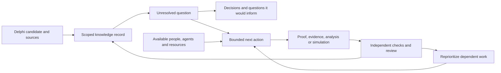

# A research commons that coordinates its next discovery

Codex API, October 31, 2026, Seattle PDT. **Product/pitch proposal responding to the user's open-problem and collective-coordination request.** This extends the narrative around the selected Scope Desk demonstration. It does not replace the director's selection, claim a deployed federation, or assign new workers. Dx-submit retains the landing page, deck, blog and storyboard; this document is a scientific/product handoff.

**Pitch:** Biology needs a shared map of what we know, where it applies, and what is worth finding out next. We turn claims and open questions into a coordinated research program: people and agents contribute evidence, proofs, simulations and experiments; checked results update the map, reveal what they unlock, and guide the next allocation of attention and resources.

**Short line:** A living research commons that turns open questions into coordinated, checkable progress.

The ambition is collective intelligence with a persistent memory and an execution loop. The initial demonstration is one small, inspectable loop, with each result's evidential limits visible.

## Build on the foundations already present

| Foundation | What we take from it | What we must demonstrate ourselves |
|---|---|---|
| Delphi | Candidate claims, equations, source records and proposed relationships | Source fidelity and conditions for operational reuse. Extracted text enters as a candidate, not an authority. |
| Scope Desk and the compiled probes | Executable scope decisions, distinguishing witnesses, a finite Price identity and conditional Hamilton corollary | Faithful statements and checked task outputs. Formal model entailment stays distinct from empirical support. |
| ASK | Versioned scientific entities that preserve evidence and scope through reuse | A result actually changes a dependent action without losing those conditions. |
| SciDEX | Open-question organization, community participation and allocation of research attention | A tightly bounded, reproducible action-to-evidence-to-next-action loop; do not claim the general coordination architecture as new. |
| Existing agent/tool environments | Workers capable of literature review, proof search, software engineering and analysis | A contribution protocol with pinned inputs, budget, ownership, output and independent acceptance. No new integration is claimed here. |

Prior-art check, October 31: Fırat's [ASK abstract](https://papers.ssrn.com/sol3/papers.cfm?abstract_id=7416579) explicitly treats traceable, versioned knowledge and reuse with preserved scope as infrastructure. [SciDEX's mission page](https://scidex.ai/quests) already describes ranked open questions, gap dependencies, resource allocation and artifact governance. These are public project descriptions, not an independent execution audit. [OpenEvidence's announcement](https://www.openevidence.foundation/announcements/introducing-the-openevidence-model-family) describes evidence synthesis and parallel literature investigation. Our proposed emphasis is the persistent, community-owned record connecting unresolved questions to subsequent executable actions. This limited comparison establishes adjacent work, not a novelty claim or a claim that those systems lack other capabilities.

## The product unit: a problem page that can launch useful work

A wiki-like page is the readable view of the record. It should answer:

1. **What do we know?** Scoped claims, sources, derivations, observations and competing explanations, with versioned provenance.
2. **What is actually unresolved?** Exact question, population/model/domain, current partial results and source-backed reason it remains open. Distinguish a field-level open problem, a project knowledge gap, an unproved formalization, a replication need and a missing measurement.
3. **What would resolve or narrow it?** Declared acceptance criteria: a proof of a specified statement, a counterexample, an adequately designed empirical test, or a reproducible numerical result. Different evidence types need different criteria.
4. **What would it unlock?** Named downstream decisions, hypotheses, tools or other questions. Edges distinguish logical necessity, empirical relevance and a proposed connection.
5. **What can we do next?** A bounded proof attempt, evidence retrieval, reanalysis, simulation or experimental protocol, with input hashes, estimated resources, stop rule and reviewer.
6. **Who is doing it?** Contributor, active lease, last progress, budget used, artifacts produced, review status and next handoff.

An agent-generated question starts as a proposal. Admission requires duplicate/prior-art checks, an identifiable uncertainty, a meaningful consequence and a feasible next action. Generating thousands of questions should not automatically consume thousands of agents. “Open as of this search” remains qualified by search scope/date; failure to retrieve a solution is not proof of novelty.

## One graph, three views

The **knowledge view** explains the current state. The **frontier view** shows unresolved questions and their possible consequences. The **action view** shows ready work, dependencies, owners and resources. Every visual edge has a type and provenance; a suggested cross-field analogy is visually different from a proved implication.

Keep epistemic attributes separate. A theorem may be formally proved under a model whose empirical adequacy is contested. A well-replicated empirical relationship may lack a mechanistic model. Neither should be forced onto one universal “verified” ladder or assigned an invented probability of truth.

## Consolidation is a first-class contribution

The scarce work includes merging duplicates, resolving naming and units, finding incompatible assumptions, retaining dissent, and connecting an older result to a newly posed question. Reward those contributions when reviewed and reused.

Cross-field matching can start with semantic retrieval and symbolic patterns, then require a mapping of variables, units, domains and assumptions. The Price-to-Hamilton connection is an existing mathematical relationship with a concrete compiled proof dependency in our probe. It illustrates reusable structure; it is not a newly discovered biological unification. Fisher's additive-genetic projection is a separate unresolved formalization here and must not be rendered as a completed edge.

Evidence aggregation should track dependence: multiple summaries of one experiment remain one underlying observation. Supporting and opposing results retain their design limitations and provenance. Probability estimates, where justified, need a defined event and calibration record. Community votes, agent agreement and market prices can express priorities or beliefs; they do not replace scientific evidence or a proof checker.

## Attention and resources follow decisions

Rank **actions**, as well as questions. A small measurement resolving a shared bottleneck may be more useful now than a broad, prestigious conjecture with no feasible next step.

Start with an explainable priority card: scientific consequence, expected change in a named decision, downstream reuse, feasibility, resource cost and uncertainty in those estimates. The value of information concerns how an answer could change the decision, including a negative answer. Avoid making “probability the preferred hypothesis is true” the allocation objective. Any combined score is a disclosed policy heuristic until its estimates are calibrated against outcomes.

Allocate a portfolio with explicit room for replication, consolidation and exploratory alternatives. These activities can be valuable even when they do not maximize a short-term completion count. Report real resource consumption and keep estimates visibly separate. Do not double-count ten duplicate descendants as ten independent benefits.

A decisive evaluation is whether coordinated allocation resolves more preregistered, decision-relevant uncertainty within the same resource budget. Compare against a persistent sequential agent, independent parallel workers, pooled-information controls where relevant, and simple deterministic scheduling. Also measure duplicate effort, failed handoffs, incorrect acceptance, verified reuse, and time/cost to an accepted result. An increase in generated questions or messages is not evidence of scientific progress. Existing project null results remain in the story.

## Decentralized participation with explicit coordination

Independent labs or communities can maintain their own records, budgets, review policies and priorities. Portable, versioned result bundles and append-only events let them exchange contributions without requiring one universal ranking or a global scientific consensus. A contested inference stays contested; different review policies can expose different accepted views while sharing the same underlying evidence.

Workers pull eligible tasks using expiring claims, declare resources, publish progress and return reproducible artifacts. A checked result triggers dependent tasks to be reconsidered. If an upstream claim is revised, affected conclusions and actions are marked for review; evidence is preserved rather than silently rewritten. Autonomy operates inside a declared budget and action contract. Mathematical checking, numerical validation and empirical review each retain their appropriate acceptance process.

Community members should be able to contribute a counterexample, replicate a run, attach a dataset, improve a statement, verify a proof, sponsor a question or execute an accepted task. Attribution follows those actual contributions. Recognition should reward useful, independently reviewed work and reuse; raw content volume and easy-to-create identities should not dominate allocation.

## Show a frontier moving on the screen

Use the existing finite-domain example as the first problem page. The question is specific: which admissible modes grow in the declared linear model, and what additional evidence is needed to predict a sustained nonlinear pattern?

Show three synchronized panels:

- The model and mode diagram, with the exact applicability result and its assumptions.
- The evidence/task graph, where the linear question has a checked receipt and nonlinear or empirical questions remain distinct.
- The action board, showing a proposed simulation or measurement, its owner/status/budget and the downstream decision it would inform.

Changing domain length updates the linear calculation. A completed, independently checked simulation can update a separate numerical outcome node. If no simulation has run, display a proposed job rather than an animation implying a result. A failed or ambiguous outcome can close an unproductive route or identify a missing condition; it remains useful progress.

Use computed visual content where it corresponds to a real task: parameter-conditioned mode plots, recorded PDE time series, sensitivity maps and convergence comparisons. Attach model, seed, numerical settings, source revision, run receipt and evidence label. GPU simulation/model inference is appropriate when a useful pilot demonstrates the need; the existing GPU owner controls submissions. Current browser mode drawings are not GPU results. BioNeMo or other model tools would enter as contributors of explicitly predicted outputs after a real integration, not as a sponsor logo standing in for evidence.

## Deliver in stages and preserve ownership

| Stage | Concrete deliverable | Current/proposed owner |
|---|---|---|
| Present the bounded loop | One problem page linking the existing walkthrough, current evidence, unresolved subquestions and a proposed next action | Dx-submit presentation; Codex science review; director integrates |
| Make the loop operational | A task/result schema, event history, leases, actual resource ledger and acceptance receipt | Existing runner owner after host confirms reassignment; no new session requested |
| Demonstrate compounding | One accepted result reused by another task, with observed dependency and saved/repeated work measured | Runner owner plus independent reviewer; matched evaluation before any advantage claim |
| Open participation | Portable contribution bundles, community review, question sponsorship and independent nodes | Later product milestone, not an existing deployment |

The current Lean pre-run review found an added-assumption target-fidelity defect and a pending-token reservation defect in the candidate runner. Both have offline reproductions. Repairing these is part of making the loop trustworthy, and new 21-record Mathlib arms remain on hold. The larger narrative must not promote an unapproved run into evidence.

A plausible initial customer hypothesis is a research group or R&D team sponsoring one mechanistic question and paying for coordinated, auditable resolution attempts. The shared public contribution could be reusable statements, methods and evidence records; hosted execution and institution-specific workflows could be services. No buyer, partnership, willingness to pay or external adoption is established by this proposal.

## Suggested spoken pitch

“AI can generate more biological hypotheses than the world can investigate. We are building a shared system for deciding what deserves attention and turning that attention into checkable progress.

“Delphi gives us candidate claims. We attach their evidence and assumptions, connect them to unresolved questions, and give people and agents bounded jobs: find evidence, prove a statement, test a model, reproduce a result. Every accepted contribution updates the common record and changes what should happen next.

“Our demonstration starts small: a biological-model claim, a scope condition that changes the answer, and a checked result that another task can reuse. The long-term product is a living research commons: what we know, what remains open, who is working on it, and which next action is worth the resources.”
